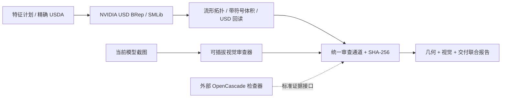

# USD BRep Review

独立的 **BRep + 视觉联合审查通道**，以 NVIDIA USD BRep / SMLib 为主适配器。由 [AICAD](https://github.com/kkppshuai-svg/ai-cad) 的统一审查通道抽出，可在命令行、Node.js 服务或其他 CAD 工作台使用，不依赖 AICAD 服务、前端、CadQuery 或 AI 账号配置。

当前阶段：`parallel-validation`；用户验收：`pending`。核心流程和真实 NVIDIA 构建/导入已测试，完整 AI 视觉质量仍需在实际场景验收。

## 与 NVIDIA 的关系

本项目直接依赖 [NVIDIA-Omniverse/usd-brep](https://github.com/NVIDIA-Omniverse/usd-brep)，调用其 `usd_brep` Python API 构建、导入、检查和再次导出精确 BRep。它是独立社区集成，不属于 NVIDIA 官方仓库，不修改或分发其内核二进制。NVIDIA 上游负责 NURBS/BRep 建模；本仓库负责联合审查、证据绑定和交付判定。API 资料见 [NVIDIA USD BRep 文档](https://nvidia-omniverse.github.io/usd-brep/)。



## 安装与运行

需要 Node.js 20+ 和 Python 3.12。JavaScript 核心无第三方依赖。原生适配器需要 `usd-brep==1.0.0`，系统运行库等要求以 NVIDIA 上游说明为准。

```bash
git clone https://github.com/kkppshuai-svg/usd-brep-review.git
cd usd-brep-review
python3.12 -m venv .venv
.venv/bin/python -m pip install -r requirements-native.txt
export USD_BREP_PYTHON="$PWD/.venv/bin/python"
npm run check
node scripts/cli.mjs build examples/plate.json --output output/plate
node scripts/cli.mjs review output/plate/native-solid.usda --output output/import-review
```

Windows PowerShell：

```powershell
py -3.12 -m venv .venv
& ./.venv/Scripts/python.exe -m pip install -r requirements-native.txt
$env:USD_BREP_PYTHON = (Resolve-Path ./.venv/Scripts/python.exe).Path
npm run check
node scripts/cli.mjs build examples/plate.json --output output/plate
node scripts/cli.mjs review output/plate/native-solid.usda --output output/import-review
```

报告保存到输出目录的 `unified-review.json`。未提供视觉审查器时，几何可通过，完整交付仍为 `pending`。CLI 退出码 0 表示几何检查通过（不能据此认定完整交付通过），1 表示几何阻断，2 表示执行或输入失败。安装到其他项目可以使用 `npm install git+https://github.com/kkppshuai-svg/usd-brep-review.git`；本包尚未发布到 npm 注册表。

## JavaScript SDK

```js
import { createNvidiaUsdBrepAdapter } from '@kkppshuai-svg/usd-brep-review';

const adapter = createNvidiaUsdBrepAdapter({ python: process.env.USD_BREP_PYTHON });
const { session } = await adapter.inspect({
  input: 'model.usda', outputDir: 'output/review',
  expected: { volumeMm3: 6898.40710525538 }
});
const report = await session.review();
console.log(report.review.geometryDecision, report.review.visualDecision, report.status);
```

`adapter.build({part, outputDir, expected})` 支持盒体、圆柱、球、打孔、方槽、并集和移动/旋转。特征输入见 `examples/plate.json`，未知特征明确报错，不自动转交 CadQuery。`adapter.inspect()` 直接从文件读取 BRep，重新计算几何并独立导出、回读；它不信任旁边已有的构建报告。

## 接入视觉审查

```js
const report = await session.review({
  screenshots, // [{view:'3d', dataUrl:'data:image/jpeg;base64,...'}, ...]
  visualProvider: async ({screenshots, revisionId, plan, geometry}) => {
    // 调用你的视觉模型或人工复核服务；必须真实检查本次截图。
    const result = await yourReviewer({screenshots, plan, geometry});
    return { ...result, revisionId }; // status、summary、findings 等
  }
});
```

视觉提供器必须回传本次 `revisionId`；只有 `status: 'pass'` 且没有矛盾的修复建议才通过。服务失败、旧版本结果或缺少视觉证据不能成为交付通过。不要把示例的版本绑定当作视觉检查本身。仓库不绑定 OpenAI、Codex 或其他供应商。

CLI 可以加载默认导出函数的视觉模块：`node scripts/cli.mjs review model.usda --output output/review --visual-provider ./my-reviewer.mjs --screenshots ./views.json`。

## 证据与覆盖范围

- 每次审查重新计算文件 SHA-256，并核对计划和策略；变化后阻断旧证据。缓存复用核对后的构建证据，不重新运行内核。
- 原生导入、建模和 USD 再导入均检查闭合流形、有限的正体积、实体数量、范围和中心；同体积的整体位置漂移也会被发现。
- 导入适配器当前接收 **单个 BRep、自包含、毫米、Z-up 的 `.usda`**；外部引用、其他单位、`.usdc` 和多 BRep 装配明确拒绝，不能静默缩放。
- SMLib 包围盒含保守扩张，不能替代精确尺寸验收；原生必需测量当前只支持体积，其他必需尺寸阻断。
- 范围和体积检查不构成全表面 Hausdorff 距离证明，也不覆盖承重、材料仿真、装配干涉或通用约束求解。单 BRep 中的实体数来自内核 census。
- 外部 OpenCascade 检查器可用 `createReviewSession({engine:'cadquery',geometry,artifactPaths,plan,outputDir})` 提交可信的标准几何证据；本仓库不内置 OCCT 执行器。见[接口与架构](docs/architecture.md)。

## 验证

`npm test` 运行独立通道测试；配置 `USD_BREP_PYTHON` 后 `npm run check` 额外运行 Python 数值测试和真实 NVIDIA 构建、导入、USD 回读、错误单位/参考体积/未知特征阻断测试。真实内核实测输出 `output/native-smoke-report.json`。测试中的视觉提供器是可控测试夹具，不代表真实 AI 视觉验收通过。

GitHub Actions 配置了独立 Node 核心及 Windows/Linux 原生检查；远端运行结果以 Actions 页面为准。

## 来源与许可

审查基础从 AICAD 的 `efaf4ab5c3ccdfa12c0762c3c79664354ce6b55e` 提取。新仓库保留版本化策略、独立几何判定和视觉交付门禁。代码采用 MIT；NVIDIA USD BRep 依赖按其上游 Apache-2.0 及第三方声明使用，见 `NOTICE`。运行配置、账号凭据和生成模型不纳入仓库。
