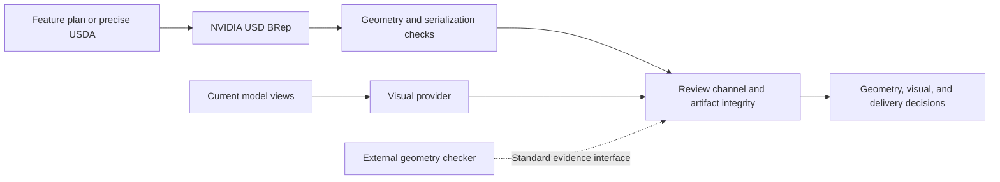

# USD BRep Review

[](https://github.com/kkppshuai-svg/usd-brep-review/actions/workflows/check.yml)
[](LICENSE)

A standalone review pipeline for CAD geometry and visual evidence, with a native adapter for [NVIDIA USD BRep](https://github.com/NVIDIA-Omniverse/usd-brep).

The review plugin also checks explicit dimensional requirements and sampled motion evidence, with version-bound repair and preservation checks. See [plugin usage and research basis](docs/plugin.md).

[简体中文](README.zh-CN.md) · [Getting started](docs/getting-started.md) · [API reference](docs/api.md) · [Validation scope](docs/validation.md) · [Contributing](CONTRIBUTING.md)

## Overview

USD BRep Review combines kernel geometry checks, artifact integrity checks, and version-bound visual review in one report. It is intended for developers building CAD automation, AI-assisted modeling tools, and USD-based workflows.

The native adapter can build a supported feature plan or inspect an existing precise USDA file. Visual review is supplied through a callback, so applications can use their own model or human review service. The pipeline returns separate geometry, visual, and delivery decisions.


*Example generated from the native STL preview of a 40 × 30 × 6 mm plate with an 8 mm through-hole. Geometry passed; visual review and delivery remain pending. See the [sample report](examples/review-report.json) and [reproduction procedure](docs/validation.md#reference-case).*

## Capabilities

| Component | Current capability |
| --- | --- |
| Native construction | Boxes, cylinders, spheres, holes, rectangular cuts, unions, and rigid transforms |
| Precise USD inspection | Import a self-contained, millimeter, Z-up USDA containing one BRep |
| Geometry evidence | Manifold topology, positive signed volume, solid count, bounds, and center |
| Serialization checks | Export and re-import, then compare geometry facts |
| Integrity checks | Recompute artifact SHA-256 and verify the plan and review policy before reusing evidence |
| Visual integration | Bind provider results to the current review version; keep delivery pending when evidence is unavailable |
| Application integration | JavaScript SDK and CLI; no third-party JavaScript runtime dependencies |

See [validation scope](docs/validation.md) for supported inputs, tolerances, and exclusions. The project is an independent community integration; NVIDIA maintains the upstream modeling library. No upstream native binaries are vendored here.

## Getting started

Requirements: Node.js 20+ and Python 3.12. The native adapter uses `usd-brep==1.0.0`. Installation instructions for Linux and Windows are in [Getting started](docs/getting-started.md).

With `USD_BREP_PYTHON` pointing to the configured Python environment:

```bash
node scripts/cli.mjs build examples/plate.json --output output/plate
node scripts/cli.mjs review output/plate/native-solid.usda --output output/review
```

The review is written to `output/review/unified-review.json`. Without a visual provider, a geometry pass produces a pending delivery decision:

```json
{
  "status": "pending",
  "review": {
    "geometryDecision": "pass",
    "visualDecision": "pending",
    "deliveryDecision": "pending"
  }
}
```

Install the SDK from GitHub:

```bash
npm install git+https://github.com/kkppshuai-svg/usd-brep-review.git
```

The package is not published to the npm registry. For repeatable application builds, pin a tested Git commit or a release tag when available.

## JavaScript example

```js
import { createNvidiaUsdBrepAdapter } from '@kkppshuai-svg/usd-brep-review';

const adapter = createNvidiaUsdBrepAdapter({
  python: process.env.USD_BREP_PYTHON
});
const { session } = await adapter.inspect({
  input: 'model.usda',
  outputDir: 'output/review'
});
const report = await session.review();
console.log(report.review.geometryDecision, report.status);
```

To combine visual evidence, pass `screenshots` and a `visualProvider` to `session.review()`. See the [provider contract](docs/api.md#visual-provider) for version binding and output fields.

## Architecture



The standard evidence interface accepts output from a trusted external checker, including OpenCascade. This repository does not include an OCCT executor. See [architecture](docs/architecture.md).

## Project status

Version 0.1.0 is in parallel validation. NVIDIA USD BRep is the primary adapter; application-level acceptance remains pending. Native construction, direct import, serialization checks, and failure gates have been exercised locally. CI runs core checks and native checks on Linux and Windows; current results are shown by the badge above.

Visual providers in automated tests are controlled fixtures. They do not establish the accuracy of a real AI visual reviewer. The pipeline does not prove full surface equivalence, manufacturing suitability, or structural performance.

## Development and support

```bash
npm test
# Includes native checks when USD_BREP_PYTHON is configured:
npm run check
```

Report reproducible failures through [GitHub Issues](https://github.com/kkppshuai-svg/usd-brep-review/issues). Contribution requirements and current priorities are described in [CONTRIBUTING.md](CONTRIBUTING.md).

If this project is useful to your CAD or USD workflow, a GitHub Star helps others discover it and lets you follow its development.

## Provenance and license

The review core was extracted from [AICAD](https://github.com/kkppshuai-svg/ai-cad), commit `efaf4ab5c3ccdfa12c0762c3c79664354ce6b55e`.

This repository is licensed under [MIT](LICENSE). NVIDIA USD BRep is a separate upstream dependency, governed by its own license and third-party notices. See [NOTICE](NOTICE).
