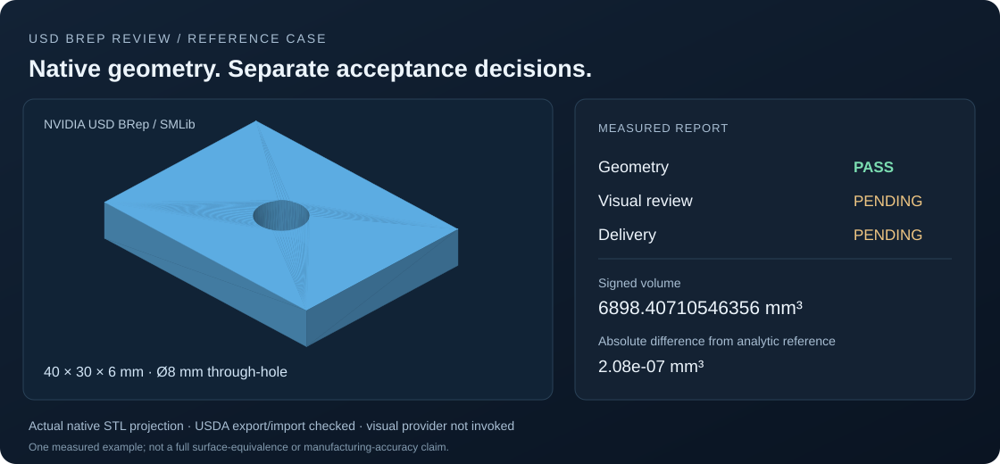

# USD BRep Review

[](https://github.com/kkppshuai-svg/usd-brep-review/actions/workflows/check.yml)
[](LICENSE)

独立的 CAD 几何与视觉证据审查通道，提供 [NVIDIA USD BRep](https://github.com/NVIDIA-Omniverse/usd-brep) 原生适配器。

[English](README.md) · [安装与运行](docs/getting-started.md) · [接口参考](docs/api.md) · [验证范围](docs/validation.md) · [贡献规范](CONTRIBUTING.md)

## 项目概述

USD BRep Review 将内核几何检查、产物完整性检查和绑定模型版本的视觉审查汇总到同一份报告，面向 CAD 自动化、AI 辅助建模工具和 USD 工作流开发者。

原生适配器支持从特征计划建模，或直接审查已有精确 USDA 文件。应用通过回调接入自己的视觉模型或人工审查服务。报告分别给出几何、视觉和完整交付结论。



*示例来自实际原生 STL 预览：40 × 30 × 6 mm 板、直径 8 mm 通孔。几何通过；视觉及交付待补充。参见[样例报告](examples/review-report.json)及[复现说明](docs/validation.md#reference-case)。*

## 当前能力

| 组件 | 已实现范围 |
| --- | --- |
| 原生建模 | 盒体、圆柱、球、打孔、方槽、并集及刚体变换 |
| 精确 USD 审查 | 单个 BRep、自包含、毫米单位、Z-up 的 USDA |
| 几何证据 | 流形拓扑、正的带符号体积、实体数、范围及中心 |
| 序列化检查 | 导出并重新导入，对比几何事实 |
| 完整性检查 | 重新核对文件 SHA-256、特征计划和审查策略，再复用证据 |
| 视觉接入 | 审查结果绑定当前版本；缺少或无法取得证据时交付保持待确认 |
| 使用方式 | JavaScript SDK、CLI；JavaScript 运行时无第三方依赖 |

本项目是独立社区集成。NVIDIA 维护上游建模库，本仓库不分发其原生二进制。输入要求、公差策略和未覆盖项目见[验证范围](docs/validation.md)。

## 快速使用

需要 Node.js 20+、Python 3.12 及 `usd-brep==1.0.0`。[安装与运行](docs/getting-started.md)提供 Linux 和 Windows 步骤。

配置 `USD_BREP_PYTHON` 后：

```bash
node scripts/cli.mjs build examples/plate.json --output output/plate
node scripts/cli.mjs review output/plate/native-solid.usda --output output/review
```

报告保存在 `output/review/unified-review.json`。未接入视觉提供器时，几何通过仍不能判为完整交付通过：

```json
{
  "status": "pending",
  "review": {
    "geometryDecision": "pass",
    "visualDecision": "pending",
    "deliveryDecision": "pending"
  }
}
```

其他项目可用 `npm install git+https://github.com/kkppshuai-svg/usd-brep-review.git` 安装 SDK；本包尚未发布到 npm 注册表。建议固定 Git 提交或可用的发布标签，以便复现。

## SDK 与视觉提供器

```js
import { createNvidiaUsdBrepAdapter } from '@kkppshuai-svg/usd-brep-review';

const adapter = createNvidiaUsdBrepAdapter({
  python: process.env.USD_BREP_PYTHON
});
const { session } = await adapter.inspect({
  input: 'model.usda',
  outputDir: 'output/review'
});
const report = await session.review();
console.log(report.review.geometryDecision, report.status);
```

`session.review({screenshots, visualProvider})` 可组合视觉结果。提供器必须实际检查本次截图，并回传当前 `revisionId`；版本过期、服务失败或缺失结果不会形成交付通过。接口约定见[API 文档](docs/api.md)。

## 验证状态

0.1.0 处于并线验证阶段，NVIDIA USD BRep 为主适配器，应用级验收仍待确认。本机已执行原生建模、直接导入、序列化回读和失败门禁测试；CI 包含 Linux/Windows 原生检查，当前结果见页面上方徽章。

自动化测试的视觉提供器是测试夹具，不代表真实 AI 视觉准确率。当前不证明全表面等价，也不包含加工适用性、承重仿真、装配干涉或通用约束求解。

## 参与项目

运行 `npm test` 检查独立审查通道；配置原生环境后，运行 `npm run check` 执行完整检查。问题请提交到 [GitHub Issues](https://github.com/kkppshuai-svg/usd-brep-review/issues)，并提供可复现输入、版本和预期结果。贡献要求见[贡献规范](CONTRIBUTING.md)。

如果它对你的 CAD 或 USD 工作流有帮助，欢迎 Star，便于关注后续适配器与验证范围更新。

## 来源与许可

审查基础从 [AICAD](https://github.com/kkppshuai-svg/ai-cad) 提交 `efaf4ab5c3ccdfa12c0762c3c79664354ce6b55e` 提取。代码采用 [MIT](LICENSE)；NVIDIA USD BRep 是独立上游依赖，按其许可证及第三方声明使用。见 [NOTICE](NOTICE)。
